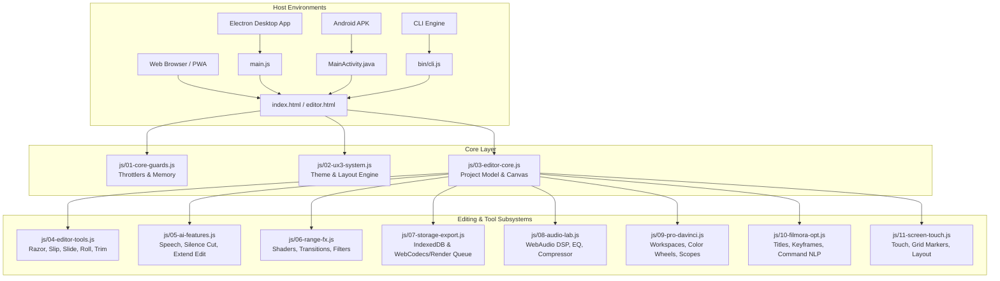

# Amiyo Studio - Architecture Map

## 1. Executive Technical Summary
Amiyo Studio is an offline-first, client-side Non-Linear Video and Audio Editing (NLE) platform. It executes natively in the browser via Web standards (HTML5 Canvas 2D, WebGL2, WebAudio, WebCodecs, IndexedDB), packages as a desktop application via Electron, and deploys as an Android application via a native WebView container.



---

## 2. Component Subsystems Breakdown

### 2.1 State Management & Data Model
- **Central Singleton**: `window.project` (defined in `js/03-editor-core.js`).
- **Data Structure**:
  ```typescript
  interface Project {
    version: string;
    metadata: {
      name: string;
      createdAt: string;
      updatedAt: string;
    };
    settings: {
      width: number;
      height: number;
      fps: number;
      background: string;
      aspect: string;
    };
    assets: Record<string, MediaAsset>;
    tracks: Track[];
    history: {
      entries: ProjectSnapshot[];
      index: number;
    };
    ai: {
      provider: string;
      endpoint: string;
    };
    versions: ProjectVersion[];
  }
  ```
- **Track Types**:
  - `video`: Primary video, B-roll, and graphic overlays.
  - `audio`: Background music, dialogue, Foley, sound effects.
  - `text`: Vector motion graphics, titles, and lower-thirds.
  - `caption`: Subtitle tracks supporting SRT/VTT timecoding.
  - `adjustment`: Grading and effect adjustment layers affecting all stacked tracks beneath.
- **Snapshot Serialization**: `serializableProject()` deep-clones project state while stripping circular blob references, runtime URLs, and historical undo cascades to prevent memory explosion.

### 2.2 Timeline Engine
- **Time Base**: Integer frame index / floating-point seconds mapped cleanly against project frame rate (default 30 fps, customizable to 24, 25, 50, 60 fps).
- **Edit Modes**:
  - `Selection (V)`: Move, select, and box-select clips across tracks.
  - `Razor (C)`: Frame-accurate splitting of clips at the playhead or cursor.
  - `Ripple Edit (B)`: Move trimmed clip edges while rippling trailing clips to close gaps.
  - `Rolling Edit (N)`: Adjust the cut boundary between two adjacent clips without changing overall sequence duration.
  - `Slip Tool (Y)`: Shift a clip's media in/out points while holding its position and duration on the timeline constant.
  - `Slide Tool (U)`: Move a clip along the timeline while dynamically trimming neighbor clips to absorb displacement.

### 2.3 Video Processing & Playback Engine
- **Double-Buffered Canvas Rendering**: `previewCanvas` (viewport) composited from `canvas` (master buffer) and per-frame reusable offscreen canvases managed by `window.amiyoScratch()`.
- **Playback Loop**: `requestAnimationFrame(tick)` driven by high-resolution timer (`performance.now()`) with clock drift compensation.
- **Color Correction Pipeline**:
  - Base adjustments: Exposure, Contrast, Highlights, Shadows, Whites, Blacks, Saturation, Temperature, Tint.
  - Wheels: Lift (Shadows), Gamma (Midtones), Gain (Highlights), Offset.
  - Scopes: Real-time luminance Waveform, RGB Parade, Vectorscope, and Histogram.

### 2.4 Audio DSP Engine
- **WebAudio Graph**:
  ```
  [Clip Media / AudioElement]
        │
        ▼
  [MediaElementAudioSourceNode]
        │
        ▼
  [StereoPannerNode] ──> [Track BiquadFilter (EQ)] ──> [DynamicsCompressorNode]
                                                               │
                                                               ▼
                                                      [Track GainNode]
                                                               │
                                                               ▼
                                                      [Master GainNode]
                                                               │
                                                               ▼
                                                    [AudioContext.destination]
  ```
- **Real-Time DSP Tools**: Parametric EQ, Dynamics Compressor, Noise Gate, Vocal Subtraction/Isolation, Reverb convolver, and Peak/RMS meters.

### 2.5 Export & Media Encoding Engine
- **Pipeline Options**:
  1. *Hardware/Native WebCodecs VideoEncoder*: Encodes discrete video chunks alongside audio frames with zero UI freezing.
  2. *Real-time MediaRecorder*: Streams master canvas buffer combined with WebAudio destination at targeted bitrates (up to 50 Mbps).
  3. *LameJS MP3 Encoder*: Audio-only MP3 export fallback with frame-accurate CBR/VBR encoding.
- **Multi-Format Presets**: 720p, 1080p, 1440p, 4K UHD, vertical 9:16 (Shorts/Reels/TikTok), square 1:1, and custom resolution/bitrate overrides.
