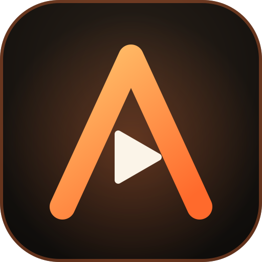

<p align="center">
  
</p>

<h1 align="center">Amiyo Studio</h1>

<p align="center">
  <strong>Private, High-Performance, In-Browser Multi-Track Video & Audio Editor</strong>
</p>

<p align="center">
  <a href="https://github.com/A2004-a/amiyo-studio/actions"></a>
  <a href="LICENSE"></a>
  
  
  
</p>

---

## 🌟 Overview

**Amiyo Studio** is a full-featured, multi-track video and audio editing suite that runs **100% inside modern web browsers** and as **native desktop applications** for Windows, Linux, and macOS. Your media never leaves your device: all decoding, timeline manipulation, effects processing, audio DSP, and exporting are computed locally on your hardware.

Originally bundled into a single massive 9.2 MB file containing 93,700+ lines, this repository features a high-performance **modular architecture** that eliminates DOM churn, accelerates startup to milliseconds, and organizes code into dedicated functional modules.

---

## 📥 Desktop Downloads (Windows, Linux, macOS, Android)

Download standalone native applications for your operating system:

| Platform | Architecture | Package Type | Direct Download Link |
| :--- | :--- | :--- | :--- |
| **Windows** | **64-bit (x64)** | Installer `.exe` | [⬇️ **Download for Windows x64 (v0.0.1)**](https://github.com/A2004-a/amiyo-studio/releases/download/v0.0.1/Amiyo-Studio-win-x64.exe) |
| **Windows** | **32-bit (x32 / ia32)** | Installer `.exe` | [⬇️ **Download for Windows x32 (v0.0.1)**](https://github.com/A2004-a/amiyo-studio/releases/download/v0.0.1/Amiyo-Studio-win-ia32.exe) |
| **Linux** | **64-bit (x86_64)** | Portable `.AppImage` | [⬇️ **Download for Linux AppImage (v0.0.1)**](https://github.com/A2004-a/amiyo-studio/releases/download/v0.0.1/Amiyo-Studio-linux-x86_64.AppImage) |
| **macOS** | **Universal (Apple / Intel)** | Disk Image `.dmg` | [⬇️ **Download for macOS DMG (v0.0.1)**](https://github.com/A2004-a/amiyo-studio/releases/download/v0.0.1/Amiyo-Studio-mac.dmg) |
| **Android** | **Universal** | Mobile `.apk` | [⬇️ **Download for Android APK**](https://github.com/A2004-a/amiyo-studio/releases/download/v1.0.1/Amiyo-Studio-android.apk) |

> [!TIP]
> All current and historical versions can be viewed on the **[GitHub Releases Page](https://github.com/A2004-a/amiyo-studio/releases)**.

---

## ✨ Features

- **🎬 Non-Linear Multi-Track Timeline**
  - Unlimited video, audio, title, and overlay tracks.
  - Real-time scrubbing with frame-accurate preview canvas.
  - Snapping, magnetic timeline, and ripple editing modes.
- **✂️ Professional Cut Suite**
  - Split clips at playhead (`S`).
  - Standard delete (`Del`) and ripple delete (`Shift + Del`).
  - Slip, slide, and extend edit tools.
- **🔊 Advanced Audio Lab**
  - Real-time multi-band parametric EQ and loudness radar.
  - AI-assisted vocal subtract / vocal isolation filters.
  - Time-stretching, pitch shifting, and FL-style sound tools.
  - Built-in LAME MP3 encoder for client-side offline audio export.
- **🎨 Color Grading & Range FX**
  - 3-way color balance, LUT filters, contrast, saturation, and curves.
  - Time-sliced Range FX engine for per-segment zoom, blur, and motion.
  - Transition shaders and clip badge overlays.
- **🖥️ Dual Professional Layout Modes**
  - **DaVinci Resolve Style**: Dedicated pages for Cut, Edit, Fusion, Fairlight, and Color.
  - **Filmora Style**: Streamlined single-window layout for rapid social content creation.
- **🤖 AI Provider Hub**
  - Unified interface for local and API-driven language and image models.
  - AI Image Studio, prompt enhancers, and subtitle auto-generation hooks.
- **⚡ WebCodecs Hardware Export**
  - Direct hardware-accelerated MP4/WebM encoding with frame-accurate canvas capture.
  - Lossless audio mixing and multi-channel rendering.
- **📱 PWA & Offline Support**
  - Installable as a native desktop or mobile PWA.
  - Local auto-save using IndexedDB. Works completely offline.

---

## 📂 Project Structure

```
amiyo-studio/
├── index.html                   # Primary application entry point (GitHub Pages ready)
├── editor.html                  # Standalone video editor entry point
├── sw.js                        # Offline Service Worker cache engine
├── install.ps1                  # Windows 1-line PowerShell installer & launcher
├── install.sh                   # macOS / Linux 1-line Bash installer & launcher
├── manifest.webmanifest         # PWA Web App Manifest
├── package.json                 # Project configuration, CLI bin & scripts
├── LICENSE                      # MIT Open Source License
├── README.md                    # Project documentation
├── .gitignore                   # Standard gitignore (excludes backups & temp files)
│
├── bin/
│   └── cli.js                   # Zero-dependency CLI web server & browser launcher
│
├── .github/
│   └── workflows/
│       ├── deploy.yml           # Automatic GitHub Pages CI/CD deployment
│       └── ci.yml               # Automated syntax & integrity validation
│
├── assets/
│   └── icons/
│       ├── icon-64.png          # 64x64 favicon
│       ├── icon-180.png         # 180x180 Apple touch icon
│       └── logo.svg             # Vector brand logo
│
├── css/
│   └── app.css                  # Unified stylesheet (378 style blocks in exact cascade order)
│
├── js/
│   ├── 01-core-guards.js        # Performance guards, event throttlers & idle management
│   ├── 02-ux3-system.js         # UX3 modern UI design system & build markers
│   ├── 03-editor-core.js        # Timeline engine, preview canvas, state & media library
│   ├── 04-editor-tools.js       # Cut suite, pro editing box, inspector & multi-track tools
│   ├── 05-ai-features.js        # AI Provider Hub, image studio & prompt tooling
│   ├── 06-range-fx.js           # Range FX engine, video effects, shaders & transitions
│   ├── 07-storage-export.js     # PWA IndexedDB storage, auto-save & WebCodecs export engine
│   ├── 08-audio-lab.js          # Audio Lab, FL audio tools, MIDI, DSP filters & voice subtract
│   ├── 09-pro-davinci.js        # DaVinci pages (Cut, Edit, Fusion, Fairlight, Color), radar
│   ├── 10-filmora-opt.js        # Filmora UI layout, command palette, themes & keyframes
│   └── 11-screen-touch.js       # Responsive layout adapters, tablet/mobile touch controls
│
└── scripts/
    ├── validate.js              # Node.js syntax & integrity validation runner
    └── build.js                 # Project build runner & bundle statistics reporter
```

---

## 🚀 Quick Start & Terminal Options

### Option 1: Instant Terminal Run (Zero Download / Setup)
Launch directly from GitHub into your browser with a single command:
```bash
npx github:A2004-a/amiyo-studio
```

### Option 2: 1-Line Terminal Download & Launch

**Windows (PowerShell):**
```powershell
irm https://raw.githubusercontent.com/A2004-a/amiyo-studio/main/install.ps1 | iex
```

**macOS / Linux (Terminal):**
```bash
curl -fsSL https://raw.githubusercontent.com/A2004-a/amiyo-studio/main/install.sh | bash
```

### Option 3: Manual Clone & Local Server
```bash
# Clone the repository
git clone https://github.com/A2004-a/amiyo-studio.git
cd amiyo-studio

# Start the high-speed local server & open browser
npm start
```

### Option 4: Direct Double-Click (No Installation Required)
Because all modules use standard relative script paths and standard browser APIs, you can simply **double-click** `index.html` (or `editor.html`) in Windows Explorer / Finder to run it directly in your browser (`file:///` protocol supported).

---

## 🌐 Deploy to GitHub Pages

This repository is **100% GitHub Pages ready** with automated GitHub Actions included:

1. Push this repository to your GitHub account:
   ```bash
   git init -b main
   git add .
   git commit -m "feat: initial commit of Amiyo Studio modular architecture"
   git remote add origin https://github.com/YOUR_USERNAME/amiyo-studio.git
   git push -u origin main
   ```
2. In your GitHub repository:
   - Go to **Settings** > **Pages** (`https://github.com/A2004-a/amiyo-studio/settings/pages`).
   - Under **Build and deployment** > **Source**, select **GitHub Actions** (this resolves the red cross on `github-pages` deployments).
3. Every push to `main` will automatically validate integrity and deploy your live site!

---

## ⌨️ Essential Keyboard Shortcuts

| Shortcut | Action |
| :--- | :--- |
| `Space` | Play / Pause playback |
| `S` | Split clip at current playhead position |
| `Del` | Delete selected clip |
| `Shift + Del` | Ripple delete selected clip (closes the gap) |
| `Ctrl + Z` / `Ctrl + Y` | Undo / Redo |
| `Ctrl + D` | Duplicate selected clip |
| `Shift + D` | Disable / Enable selected clip |
| `\` | Fit timeline to current viewport |
| `Alt + Scroll` | Zoom timeline centered around mouse pointer |
| `=` / `-` | Zoom in / Zoom out timeline |
| `Up` / `Down` | Jump to previous / next edit point |
| `M` | Add timeline marker |
| `D` | Select clip under playhead |
| `\`` (Backtick) | Maximize panel under mouse pointer |
| `Esc` | Close active dialog / modal |

---

## 🧪 Testing & Validation

Run the built-in integrity validator to ensure all 11 modules and stylesheets are free from syntax errors:

```bash
npm run validate
```

Generate bundle statistics:

```bash
npm run build
```

---

## 📄 License

This project is licensed under the [MIT License](LICENSE) - see the LICENSE file for details.

